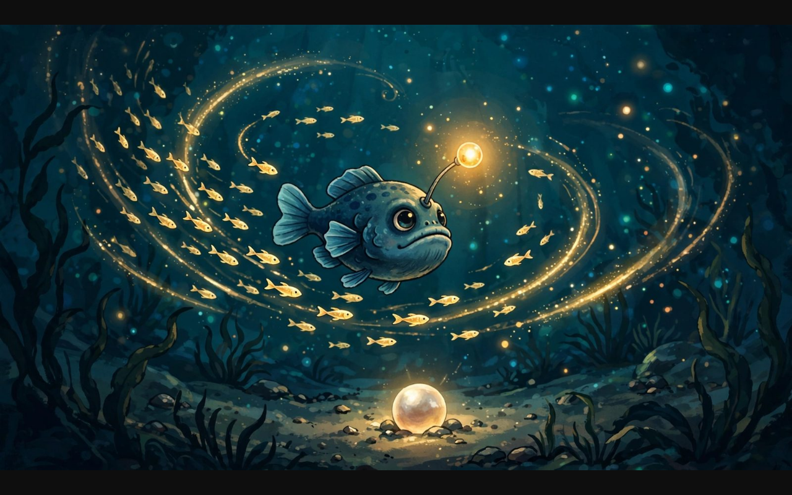
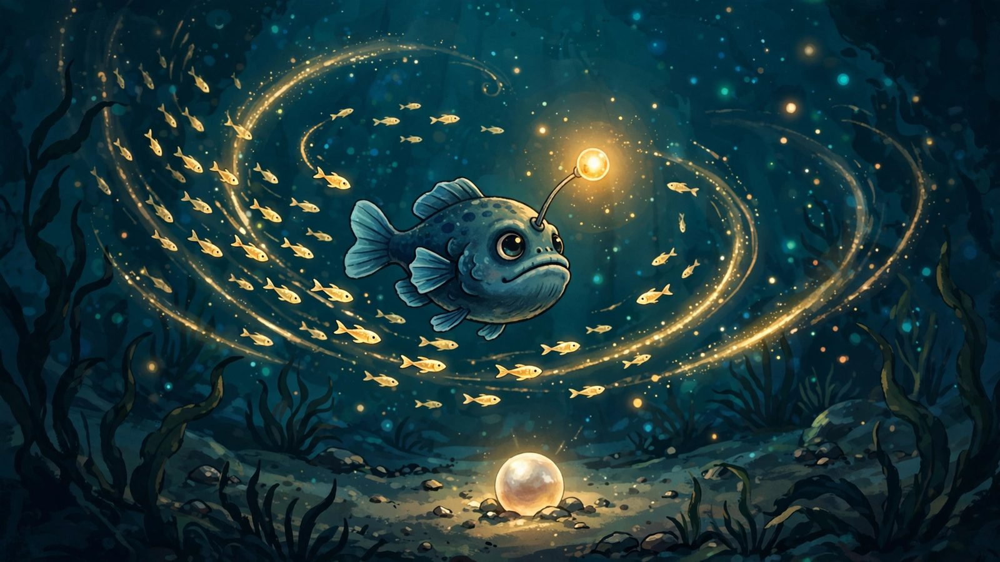

# Abyssal Bloom — a deep-sea light story 🐟💡

## Screenshot







[](LICENSE)


A 2D exploration game built with **GameMaker (100% GML, no drag-and-drop)**. The reef has gone dark. You are a small lanternfish with one light — catch glimmerfish to free their pearls, gather **five pearls**, and watch the whole reef bloom from cold black into full colour.

## Features

- 🌊 **Big scrolling world** — a 3200×2000 reef with a camera that follows your lanternfish
- 🐟 **Living ecosystem** — glimmerfish swim in sine-wave schools and scatter when the whale sings
- 💡 **Light the way** — click anemone lamps to wake them and push back the darkness
- 🦪 **Pearl quest** — catch glimmerfish to release pearls; pearls drift toward you; 5 pearls bloom the reef
- 🐋 **Whale song events** — every 20 seconds a whale sings and the glimmerfish scatter
- 🎬 **Full game flow** — animated splash screen, title screen, pause, and win screen with replay
- 🎨 **Dynamic recolouring** — the entire room shifts from cold black to full colour as you collect pearls

## Controls

| Input | Action |
|---|---|
| `WASD` / Arrow keys | Swim (glides with water drag) |
| Touch a glimmerfish | Catch it — a pearl drops out |
| Touch a pearl | Collect it (pearls also drift toward you) |
| Click a nearby lamp | Wake it and light the area |
| `P` / `Esc` | Pause (`T` on pause or win screen = back to title) |
| `Enter` (after winning) | Dive again |

## How to open in GameMaker

1. Unzip/clone to a folder that is **NOT** synced by OneDrive / iCloud / Dropbox, e.g. `C:\GameMakerProjects\Assignment1`
2. Double-click **`Assignment1.yyp`** (or File → Open in GameMaker)
3. If GameMaker offers to upgrade the project, say yes
4. Press **F5** to run

> Requires GameMaker (2022+ recommended). No extensions or marketplace assets needed.

## Project structure

```
Assignment1.yyp          GameMaker project file (open this)
├── objects/             Game logic (all GML)
│   ├── o_angler/        Player — the lanternfish (swim, catch, collisions)
│   ├── o_glimmer/       Glimmerfish — sine-wave swim, dodge, scatter
│   ├── o_pearl/         Pearls — sink, drift toward player, collect
│   ├── o_lamp/          Anemone lamps — click to wake and light
│   ├── o_reef/          Controller — darkness, camera, particles, whale alarm, HUD, win
│   ├── o_decor/         Parent for swaying scenery (kelp, coral, rock, seabed)
│   └── o_splash/ o_title/ o_fade/   Screens and transitions
├── sprites/             Art assets (water, fish, lamps, decor, sprite fonts)
├── rooms/               rm_reef (3200×2000) and screen rooms
├── sounds/              (optional — see below)
└── extra_sounds/        5 bonus .wav files (drag into GameMaker's Sounds folder)
```

## Optional sounds

`extra_sounds/` holds five `.wav` files (`snd_catch`, `snd_pearl`, `snd_lamp`, `snd_whale`, `snd_win`). Drag them into the **Sounds** folder in GameMaker and keep their names — the code plays them automatically once they exist. The game runs fine without them.

## 🔊 VN retro SFX pack

`sfx/` contains a bonus retro sound pack generated for this project (16-bit mono WAVs, GameMaker-ready):

| File | Use it for |
|---|---|
| `snd_catch.wav` | Glimmerfish caught |
| `snd_pearl.wav` | Pearl collected |
| `snd_lamp.wav` | Anemone lamp wakes |
| `snd_splash.wav` | Splash / dive transitions |
| `snd_win.wav` | Reef-bloom victory fanfare |
| `snd_bubbles_loop.wav` | 8-second loopable underwater ambience |

**How to wire them into the GameMaker project** (2 minutes, no code changes to the project file needed):

1. In GameMaker, right-click **Sounds** → **Create → Sound** for each `.wav`, keeping the names above (the game's code already calls `audio_play_sound(snd_catch, …)` etc. when a sound with that name exists).
2. For the ambience loop: create the sound, then in `o_reef`'s Create event add one line:
   ```gml
   audio_play_sound(snd_bubbles_loop, 10, true); // priority 10, looped
   ```
3. Press F5 — the reef now sings.

> Four of the six sounds are real studio SFX from [Kenney's CC0 audio packs](https://kenney.nl/assets) (no attribution required); the splash and bubble-loop are synthesized originals since Kenney has no water sounds. Full provenance in [ASSETS.md](ASSETS.md).

## Assignment rubric coverage

<details>
<summary>How this project maps to the GML assignment rubric</summary>

| # | Requirement | Where |
|---|---|---|
| 1 | GML project named Assignment1, no drag-and-drop | `Assignment1.yyp`, every event is GML (`isDnD = false`) |
| 2 | Big room | `rm_reef` is 3200×2000 (view 1280×720) |
| 3 | Background sprite assets | `s_water` background layer + kelp, coral, rock, seabed scenery (`o_decor` parent, 4 children) |
| 4 | 3+ distinct objects | `o_angler`, `o_glimmer`, `o_pearl`, `o_lamp`, `o_reef`, decor family |
| 5 | Meaningful interaction | Catching a glimmerfish releases a pearl; pearls pull toward the player; 5 pearls re-colour the room (the win) |
| 6 | Keyboard player | `o_angler` Step event (WASD / arrows) |
| 7 | Viewport follows player | `o_reef` End Step moves `view_camera[0]` |
| 8 | Automatic movement | `o_glimmer` Step (sine-wave swim + dodge), `o_pearl` Step (sink / drift) |
| 9a | Step event | `o_angler`, `o_glimmer`, `o_reef` |
| 9b | Alarm | `o_reef` Alarm 0 — whale song every 20 s |
| 9c | Collision | `o_angler` × `o_glimmer`, `o_angler` × `o_pearl` |
| 9d | Other event | `o_lamp` Mouse Left Pressed |
| 10 | Comments | Every event has a `/// @description` line plus `//` and `/* */` comments |

</details>

## Fonts

In-game text uses sprite fonts baked from **Lora** and **Poppins** (SIL Open Font License).

## License

MIT © Vivek Nair — see [LICENSE](LICENSE).

---

**Crafted by [Vivek Nair](https://github.com/vivekn4) · VN**
